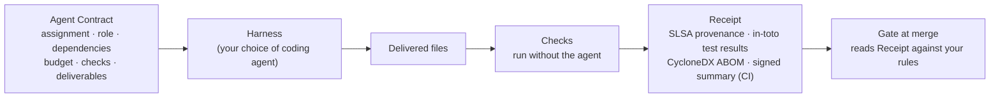

# Agent Contracts & Receipts

> **Trust in agent-built software can't come from the model, or from reading
> its output. It has to come from the system that produces it — engineered and
> attested like any software supply chain, on open standards.**

This repository holds **format draft 0.1** for two artifacts. An **Agent
Contract** defines one unit of agent work before it runs: its assignment,
role, dependencies, budget, checks and deliverables, in a Markdown file with
YAML front matter. A **Receipt** is the evidence each run leaves about the
files it delivered: one in-toto bundle with SLSA provenance, in-toto test
results and a CycloneDX agent bill of materials (ABOM). In CI, a trusted
signer the agent can't reach signs a verification summary that binds it.
Contracts compose into an agentic software factory; a gate at merge reads
Receipts against your rules.

**Status: draft 0.1 — an invitation, not a standard.** It is generalised from
one implementation and will change. Read it, break it, tell us what's missing.

## Read the draft

1. [spec/README.md](spec/README.md): overview, terminology, scope, non-goals
2. [spec/contract.md](spec/contract.md): the Agent Contract
3. [spec/receipt.md](spec/receipt.md): the Receipt, as a profile over in-toto, SLSA and CycloneDX
4. [spec/gate.md](spec/gate.md): what a gate should verify, and its limits
5. [spec/open-questions.md](spec/open-questions.md): where we need help

A real contract and a real, trimmed Receipt are in [spec/examples/](spec/examples/).
The longer argument is the essay *Agent Contracts and Receipts: toward
verifiable agentic software factories*, at [theainativemind.com/blog/agent-contracts-and-receipts](https://theainativemind.com/blog/agent-contracts-and-receipts/). Background is in
[The Agentic SDLC Handbook](https://danielmeppiel.github.io/agentic-sdlc-handbook/):
the [thesis](https://danielmeppiel.github.io/agentic-sdlc-handbook/handbook/ch01-the-agentic-sdlc-thesis.html), the
[deterministic/probabilistic boundary](https://danielmeppiel.github.io/agentic-sdlc-handbook/handbook/ch16-deterministic-probabilistic-boundary.html),
[primitives as code](https://danielmeppiel.github.io/agentic-sdlc-handbook/handbook/ch21-primitives-as-code.html) and
[what comes next](https://danielmeppiel.github.io/agentic-sdlc-handbook/handbook/ch27-what-comes-next.html).

## Implementations

- [APMX](https://github.com/danielmeppiel/apmx): one open-source
  implementation (Apache-2.0). It runs contracts with Copilot CLI or OpenCode,
  writes Receipts, signs them in CI and gates pull requests with `apmx audit`.
  It is independent and experimental.
- [APM](https://github.com/microsoft/apm), Microsoft's open-source Agent
  Package Manager, is the package manager APMX uses for contract and skill
  dependencies, and the source of the CycloneDX inventory.

If you implement any part of this draft, open an issue so we can list it.

## Participate

- **Discuss first:** [Discussions](https://github.com/danielmeppiel/agent-contracts/discussions)
  for questions, use cases and the [open questions](spec/open-questions.md).
- **Issues** for concrete defects: an ambiguity, a wrong use of an underlying
  standard, a claim the implementation does not back.
- **Pull requests** for agreed changes. See [CONTRIBUTING.md](CONTRIBUTING.md).

## Licences

- Specification text (`spec/*.md`): [CC-BY-4.0](LICENSE-docs).
- Schemas and examples (`spec/schemas/`, `spec/examples/`): [Apache-2.0](LICENSE).

By Daniel Meppiel, as personal, independent work.
